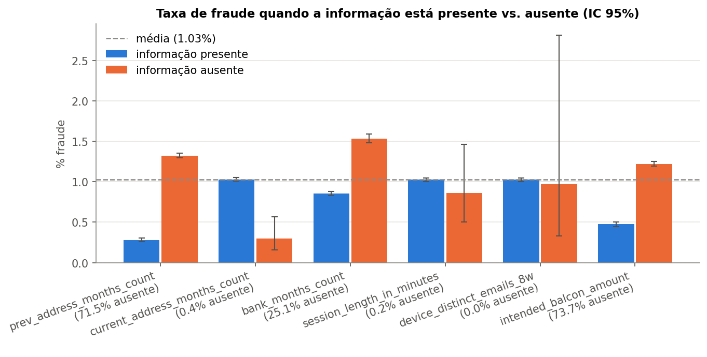
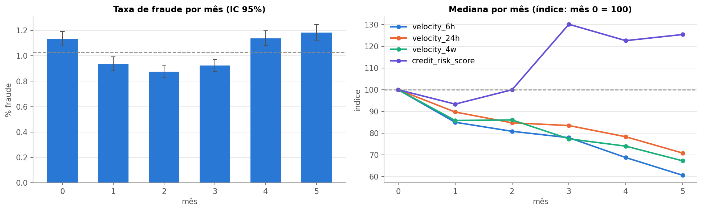
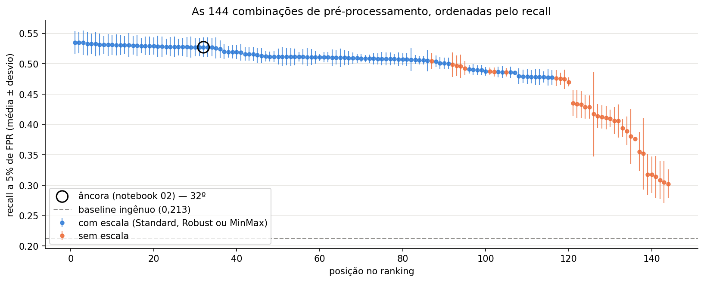
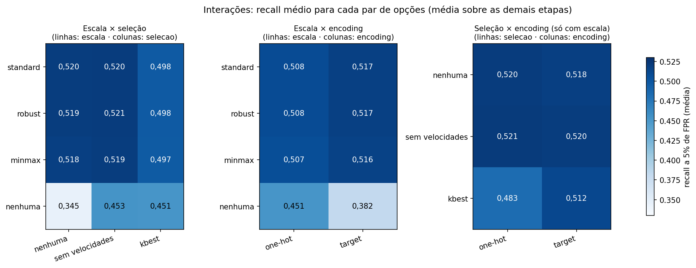
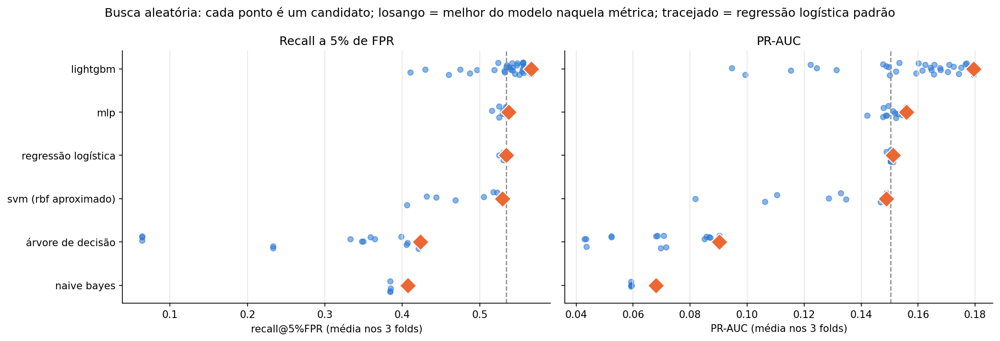
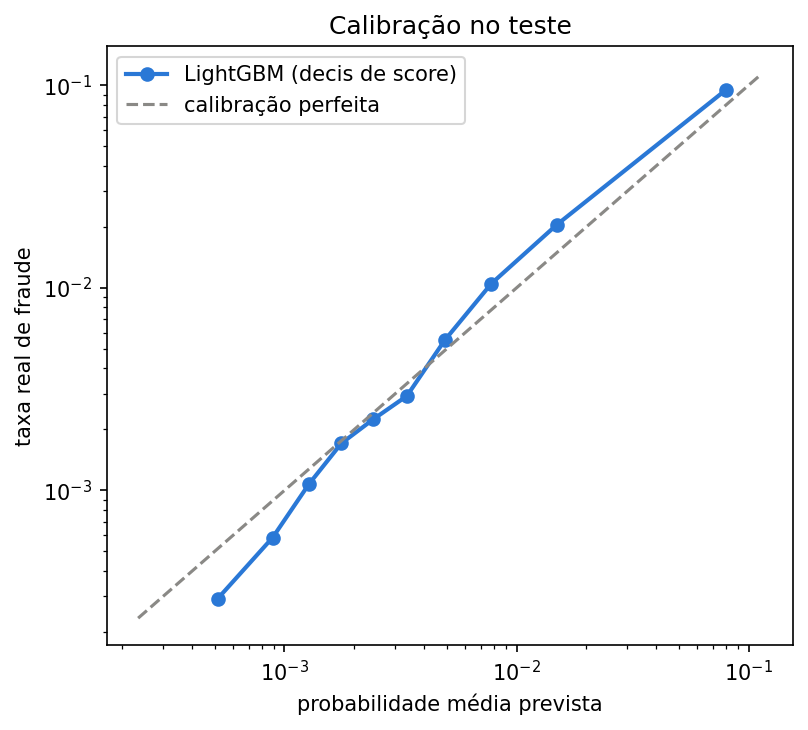
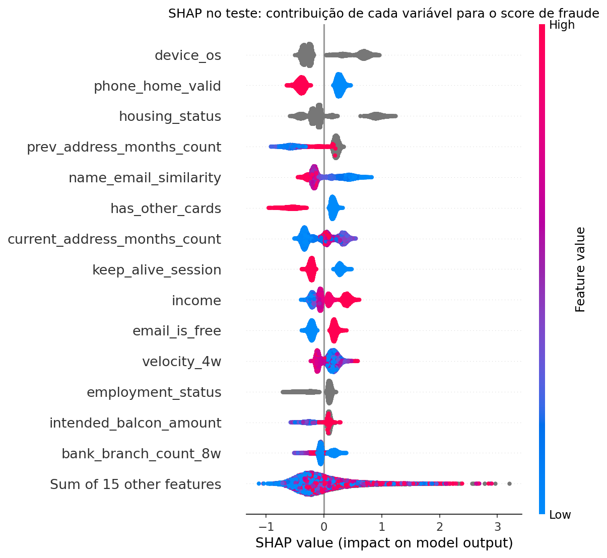
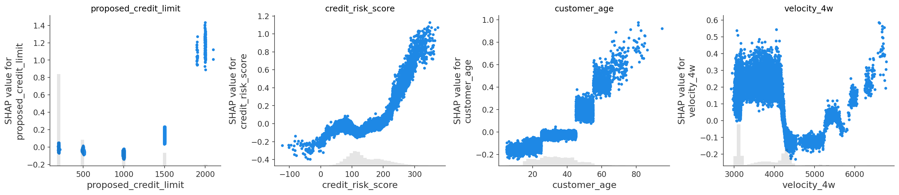
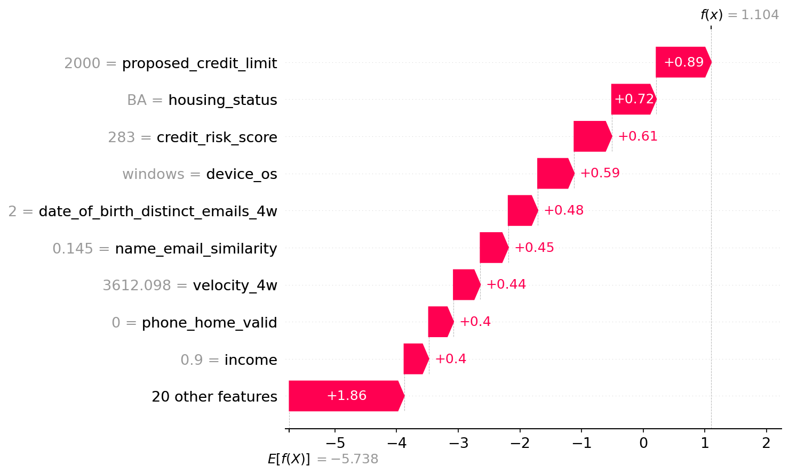

# Detecção de fraude na abertura de contas bancárias

Modelo de machine learning para identificar pedidos fraudulentos de abertura de conta, com foco em **validação temporal sem vazamento de dados**, **métrica de negócio** (recall a 5% de taxa de falsos positivos), **estabilidade operacional** diante de mudanças nos dados e **justiça algorítmica** por faixa de idade.

> **Resultado final (teste, meses nunca vistos):** um LightGBM detecta **54,9% das fraudes** barrando apenas **5% dos clientes legítimos** — contra 51,0% de uma regressão logística e 21,3% de uma regra de uma única variável. Com a política de limiar recomendada, a taxa de falsos positivos fica estável (4,9% e 4,8% nos dois meses de teste) e o volume de revisão é constante.

| | Recall a 5% FPR | PR-AUC | ROC AUC |
|---|---|---|---|
| **LightGBM (modelo final) — teste** | **0,549** | **0,196** | **0,896** |
| Regressão logística (régua) — teste | 0,510 | 0,168 | 0,884 |
| LightGBM — validação temporal (3 folds) | 0,566 | 0,178 | 0,908 |

---

## Sumário

1. [O problema](#1-o-problema)
2. [Os dados](#2-os-dados)
3. [Metodologia](#3-metodologia)
4. [Análise exploratória](#4-análise-exploratória)
5. [Baseline](#5-baseline)
6. [Estudo de pré-processamento (144 pipelines)](#6-estudo-de-pré-processamento-144-pipelines)
7. [Comparação de modelos](#7-comparação-de-modelos)
8. [Modelo final no teste](#8-modelo-final-no-teste)
9. [Limitações e próximos passos](#9-limitações-e-próximos-passos)
10. [Como reproduzir](#10-como-reproduzir)

---

## 1. O problema

Fraude na abertura de contas acontece **antes de qualquer transação**: alguém usa uma identidade falsa ou roubada para abrir uma conta que depois será usada para golpes. O modelo precisa decidir, só com os dados do cadastro, quais pedidos merecem revisão.

O desafio tem três camadas:

- **Desbalanceamento:** ~1% dos pedidos são fraude. Um modelo que diz "nunca é fraude" acerta 99% e é inútil.
- **Custo assimétrico:** barrar um cliente legítimo tem custo (atrito, perda de cliente). O banco tolera barrar no máximo uma pequena fração deles.
- **Dados que mudam no tempo:** padrões e até a proporção de fraudes variam de um mês para outro.

## 2. Os dados

**Bank Account Fraud (BAF) — Base**, publicada no NeurIPS 2022 (Jesus et al., *Turning the Tables: Biased, Imbalanced, Dynamic Tabular Datasets for ML Evaluation*) e disponível no [Kaggle](https://www.kaggle.com/datasets/sgpjesus/bank-account-fraud-dataset-neurips-2022). É uma base sintética, gerada a partir de dados reais com técnicas que preservam a privacidade.

- 1.000.000 de pedidos, 30 atributos (renda, idade, tempo no endereço, dispositivo, score de crédito, limite proposto, "velocidades" de pedidos etc.), 8 meses.
- **Divisão temporal**, seguindo o protocolo do artigo: **treino = meses 0–5** (794.989 pedidos, 1,03% de fraude) e **teste = meses 6–7** (205.011 pedidos, 1,40% de fraude).

O teste foi separado já no download (`00_download_dados.ipynb`) e aberto **uma única vez**, no notebook final.

## 3. Metodologia

### Métricas

| Métrica | Papel | Por quê |
|---|---|---|
| **Recall a 5% de FPR** | Principal | Restrição de negócio: barrando no máximo 5% dos legítimos, que fração das fraudes é pega? É também o protocolo do artigo da base. |
| **PR-AUC** | Secundária | Foca na classe rara e penaliza falsos positivos; com ~1% de positivos, a ROC AUC pode parecer alta mesmo com precisão baixa. |
| **ROC AUC** | Secundária | Independente de limiar; comparável com a literatura. |

Acurácia foi descartada. Em termos operacionais, operar a 5% de FPR com recall de ~55% significa, a cada 10 mil pedidos, revisar ~490 legítimos para pegar ~77 das ~140 fraudes (≈ 1 fraude a cada 7 contas barradas) — por isso o modelo alimenta uma **fila de revisão manual**, não um bloqueio automático.

### Validação temporal

A EDA mostrou que os dados mudam com o tempo (*drift*). Validação cruzada aleatória "preveria o passado" e daria números otimistas. Usamos **janela crescente**:

| Fold | Treina nos meses | Valida no mês |
|---|---|---|
| 1 | 0–2 | 3 |
| 2 | 0–3 | 4 |
| 3 | 0–4 | 5 |

A média dos folds estima o desempenho; o desvio mede a estabilidade.

### Sem vazamento de dados

- **Limpeza sem estado** (códigos de ausência → `NaN`, valores impossíveis → 0) fora do pipeline: não aprende nada dos dados.
- **Transformações com estado** (mediana, padronização, one-hot, undersampling) dentro de um `Pipeline`, ajustado **só no treino de cada fold**. Verificado explicitamente: a média aprendida pelo `StandardScaler` coincide com a do treino do fold, não com a da validação.
- O undersampling, quando usado, age só no treino (`imblearn.Pipeline`); a validação mantém a proporção real.

## 4. Análise exploratória

📓 [`notebooks/01_eda.ipynb`](notebooks/01_eda.ipynb) — feita **só nos meses de treino**, com intervalos de confiança (Wilson) em todas as taxas de fraude.

**Valores ausentes são informativos.** Quem não informa o endereço anterior frauda **4,7×** mais; a ausência do valor de transferência inicial, 2,6×. Preencher pela média apagaria esse sinal.



**Sinais fortes:** `housing_status = BA` (3,4× a média), `device_os = windows`, `employment_status = CC`; nas binárias, quem não tem outros cartões no banco (2,9×), não mantém a sessão ativa (2,6×) ou não tem telefone fixo válido (2×). **Limite de crédito proposto de ~2.000: 12,5% de fraude**, cerca de 12× a média. A idade cresce monotonicamente: 50+ anos fraudam 2,9× mais.

**Drift temporal.** As três variáveis de "velocidade" caem 29–39% em 6 meses; o `credit_risk_score` muda de patamar no mês 3; a taxa de fraude varia entre meses.



## 5. Baseline

📓 [`notebooks/02_baseline.ipynb`](notebooks/02_baseline.ipynb)

| Modelo | Recall a 5% FPR | PR-AUC | ROC AUC |
|---|---|---|---|
| Ingênuo (`credit_risk_score` como score) | 0,213 ± 0,018 | 0,030 ± 0,003 | 0,685 ± 0,024 |
| **Regressão logística** | **0,527 ± 0,016** | **0,151 ± 0,011** | **0,896 ± 0,010** |

- **Importância por permutação** medida pelas três métricas: as cinco variáveis mais importantes coincidem nas três; `proposed_credit_limit` e `credit_risk_score` — sinais fortes na EDA — quase não são usados por um modelo **linear**, que não representa relações em degrau. Hipótese: um modelo não linear as aproveitaria.
- **Ponto de operação:** um limiar fixado no treino gera FPR de 7,7% / 6,1% / 3,2% no mês seguinte (planejado: 5%) — o drift chega à operação.
- **Justiça:** legítimos com 50+ anos são barrados ~3,5× mais (razão de FPR de 0,28).

## 6. Estudo de pré-processamento (144 pipelines)

📓 [`notebooks/03_preprocessamento.ipynb`](notebooks/03_preprocessamento.ipynb) — todas as combinações de 5 etapas, cada uma testando uma hipótese da EDA, com regressão logística nos 3 folds:

| Etapa | Opções |
|---|---|
| Ausentes | mediana **com** indicador de ausência · mediana sem indicador |
| Encoding | one-hot · target encoding |
| Escala | Standard · Robust · MinMax · nenhuma |
| Balanceamento | nenhum · `class_weight` · undersampling (1:10) |
| Seleção | nenhuma · sem as velocidades · SelectKBest (20) |



**Efeito pareado** de cada decisão (comparando combinações idênticas em todo o resto):

| Decisão | Impacto no recall |
|---|---|
| Escalar as variáveis | **+0,096** — sem escala o otimizador não converge |
| Indicador de ausência | +0,014 (melhora em 83% dos pares) — confirma a EDA |
| Tipo de escala | < 0,003 (Robust falhou em convergir com target encoding) |
| Balanceamento | < 0,005 — as métricas avaliam a ordenação |
| SelectKBest | **−0,022** (piora em 100% dos pares com escala) |

**Platô:** as 20 melhores combinações ficam entre 0,529 e 0,535. Com o básico bem feito, **o limite passa a ser o modelo, não os dados**.

**Interações:** sem escala, remover as velocidades "salva" o modelo (+0,11) — não porque ajude, mas porque elas, na casa dos milhares, dominam o otimizador. A aparente vantagem do target encoding vem só das combinações com SelectKBest (menos colunas para cortar).



Como não existe pré-processamento ótimo universal, os modelos seguintes usam **dois perfis**: *sensíveis à escala* (mediana + indicador, one-hot, Standard, undersampling) e *árvores* (ausentes como `NaN` e categorias nativas, sem escala).

## 7. Comparação de modelos

📓 [`notebooks/04_modelos.ipynb`](notebooks/04_modelos.ipynb) — busca aleatória de hiperparâmetros (80 candidatos), avaliada nos mesmos folds temporais.

| Modelo (melhor candidato) | Recall a 5% FPR | PR-AUC | ROC AUC |
|---|---|---|---|
| **LightGBM** (#11, `scale_pos_weight = 3`)¹ | **0,566** | **0,177** | **0,908** |
| Rede neural (MLP) | 0,537 | 0,153 | 0,897 |
| Regressão logística | 0,534 | 0,150 | 0,896 |
| SVM (RBF aproximado via Nystroem) | 0,529 | 0,147 | 0,895 |
| Árvore de decisão | 0,423 | 0,086 | 0,811 |
| Naive Bayes | 0,407 | 0,068 | 0,856 |

¹ *Valores da busca. O modelo final usa `scale_pos_weight = 1` (ver o último item abaixo): 0,566 · 0,178 · 0,908.*



- O LightGBM supera a régua em **+0,032 de recall nos 3 folds** — 4× o maior ganho obtido com pré-processamento.
- Rede neural e SVM empatam com a logística, como costuma acontecer em dados tabulares.
- A árvore isolada sofre com **empates**: folhas grandes dão o mesmo score a muitos pedidos, e o limiar de 5% de FPR cai no meio de uma folha.
- No LightGBM, **a taxa de aprendizado domina** (ρ = −0,87 com o recall); com todos os dados e taxa alta, há sobreajuste forte. Undersampling empata com o treino completo após o ajuste.
- **Ajuste final:** `scale_pos_weight` de 3 → 1 mantém o recall (0,5665) e elimina a distorção das probabilidades (com peso 3, a probabilidade média prevista era quase o dobro da taxa real).

## 8. Modelo final no teste

📓 [`notebooks/05_modelo_final.ipynb`](notebooks/05_modelo_final.ipynb) — LightGBM treinado nos meses 0–5 e avaliado **uma única vez** nos meses 6–7. As previsões foram **registradas antes** de abrir o teste:

| Previsão | Resultado |
|---|---|
| Recall menor que na validação (~0,50–0,55) | ✅ 0,549 (validação: 0,566) |
| Vantagem sobre a logística se mantém (~+0,03) | ✅ +0,039 |
| PR-AUC maior, pela taxa de fraude maior | ✅ 0,196 com 1,40% de fraude |

Não previsto: o mês 7 foi **melhor** que o mês 6 (0,580 vs. 0,525) — nos dois modelos. Drift não significa piora monotônica.

### Política de limiar

O recall acima supõe um limiar que dá exatamente 5% de FPR no teste — impossível de escolher de antemão. Três políticas, todas definidas sem olhar o teste:

| Política | FPR mês 6 | FPR mês 7 | Alertas por 10 mil |
|---|---|---|---|
| (a) Limiar fixo, calculado no treino | 6,3% | 5,3% | 697 / 612 |
| (b) Limiar fixo, calibrado fora do treino | 6,5% | 5,5% | 722 / 631 |
| **(c) Orçamento: revisar os 5,5% mais suspeitos** | **4,9%** | **4,8%** | **553 / 553** |

Limiares fixos erram por causa do drift dos scores — e calibrar fora do treino não resolveu. O **orçamento de alertas** mantém a FPR estável e o volume de revisão constante: é a política recomendada (em produção, com o percentil calculado numa janela móvel).

### Justiça por idade

| | FPR < 50 anos | FPR ≥ 50 anos | Razão de FPR | Recall global |
|---|---|---|---|---|
| Limiar único | 3,7% | 11,5% | 0,33 | **0,549** |
| Limiar por grupo | 5,0% | 5,0% | 1,00 | 0,520 |

Com limiar único, legítimos com 50+ anos são barrados **3,1× mais**, refletindo a taxa de fraude 2,7× maior nesse grupo. Igualar a FPR custa 0,029 de recall — **menos que o ganho do LightGBM sobre a logística**: o modelo corrigido (0,520) ainda supera a logística sem restrição (0,510). Usar a idade explicitamente na decisão tem implicações regulatórias; a escolha é de negócio, e a análise a torna quantificável.

### Calibração

A taxa real de fraude cresce monotonicamente com o score (0,03% no 1º decil, 9,5% no 10º). O modelo prevê em média 1,18% contra 1,40% reais: a proporção de fraudes subiu em relação ao treino, e o modelo — treinado no passado — não acompanha. Como a política recomendada é por ranking, isso não altera quem é revisado.



### Interpretabilidade (SHAP)



- As variáveis mais importantes coincidem com as da regressão logística.
- **Sinais raros e fortes:** `proposed_credit_limit` é só a 22ª variável pela média do |SHAP|, mas tem a **maior contribuição de todas no percentil 99,9**: limites de ~2.000 multiplicam a chance de fraude por ~3. `credit_risk_score` tem forma de "taco de hóquei". A hipótese do baseline se confirma — e mostra que **a média do |SHAP| esconde sinais raros**.
- **Alerta:** `velocity_4w` funciona como um "relógio disfarçado". Como caiu ao longo dos meses enquanto a fraude subiu, o modelo aprendeu um efeito de **tempo**, não de fraude — provável causa da instabilidade dos limiares fixos.



Cada decisão pode ser explicada individualmente — abaixo, uma fraude real com 75% de probabilidade prevista, resultado do acúmulo de vários sinais de alerta:



## 9. Limitações e próximos passos

- **Velocidades como indicador de tempo:** retreinar sem as variáveis de velocidade e comparar a estabilidade do limiar. Pela regra do projeto, o modelo não foi alterado depois de abrir o teste.
- **Drift:** monitorar a taxa de fraude, a distribuição dos scores e o recall em produção, com retreino periódico e recalibração das probabilidades.
- **Justiça:** avaliar técnicas além do limiar por grupo (restrições no treino, por exemplo) e outras faixas etárias.
- **Dados sintéticos:** a base foi gerada por modelos generativos a partir de dados reais; alguns artefatos (como velocidades negativas) indicam que nem todo padrão corresponde ao mundo real.
- **Viés de seleção:** a validação escolhe o melhor entre dezenas de candidatos; por isso a avaliação final ficou restrita a um teste usado uma única vez.

## 10. Como reproduzir

### Estrutura

```
fraude-abertura-conta/
├── notebooks/
│   ├── 00_download_dados.ipynb     # download e separação treino/teste
│   ├── 01_eda.ipynb                # análise exploratória
│   ├── 02_baseline.ipynb           # validação temporal, métricas, regressão logística
│   ├── 03_preprocessamento.ipynb   # grade de 144 pipelines
│   ├── 04_modelos.ipynb            # 6 modelos, busca aleatória
│   └── 05_modelo_final.ipynb       # teste, limiar, justiça, SHAP
├── src/
│   ├── preprocessamento.py         # grupos de colunas e limpeza sem estado
│   ├── validacao.py                # folds temporais e métricas
│   ├── perfis.py                   # pipelines por família de modelo
│   ├── experimentos.py             # busca paralela com retomada
│   └── prever.py                   # inferência em novos pedidos
├── models/
│   ├── lightgbm_final.joblib       # pipeline completo (pré-processamento + modelo)
│   └── metadados.json              # hiperparâmetros, métricas, política de limiar, versões
├── reports/                        # figuras e resultados (CSV) de cada notebook
├── data/                           # não versionada — criada pelo notebook 00
└── requirements.txt
```

### Ambiente

Testado com Python 3.12–3.14.

```bash
python -m venv .venv
source .venv/bin/activate            # Windows: .venv\Scripts\Activate.ps1
pip install -r requirements.txt
```

### Execução

Rode os notebooks em ordem, de `00` a `05`. O `00` baixa a base (~530 MB) via `kagglehub`, sem necessidade de login. Os notebooks também funcionam no Google Colab (os caminhos se ajustam automaticamente).

Tempos aproximados (notebook com 12 núcleos): a grade do `03` leva ~75 min e a busca do `04` ~1 h, ambas em paralelo e **retomáveis** — se interrompidas, continuam de onde pararam. Os resultados já estão salvos em `reports/`.

### Inferência

```bash
python -m src.prever pedidos.csv resultado.csv          # política de orçamento (lotes ≥ 1.000 pedidos)
python -m src.prever pedidos.csv resultado.csv 0.12     # limiar fixo (pedidos individuais)
```

A saída traz a probabilidade de fraude e a indicação de revisão para cada pedido.

---

**Autor:** João Gustavo G. Pires — estudante de Engenharia da Computação no Centro de Informática (CIn) da UFPE · [LinkedIn](https://www.linkedin.com/in/jo%C3%A3o-gustavo-pires-724034260/)